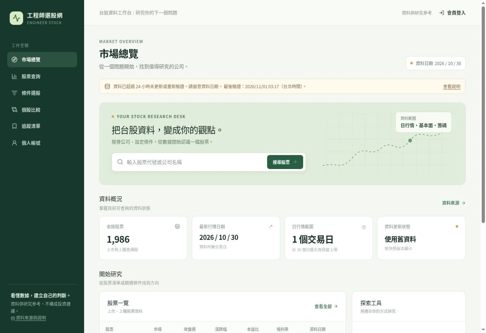
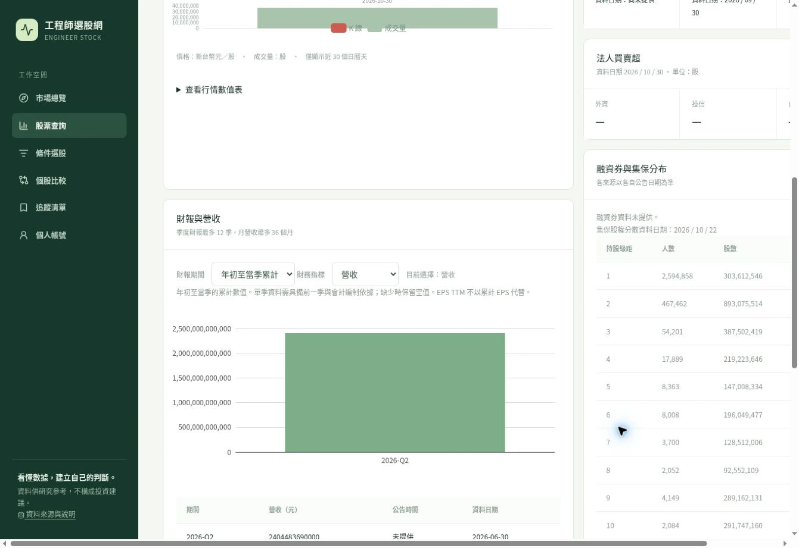
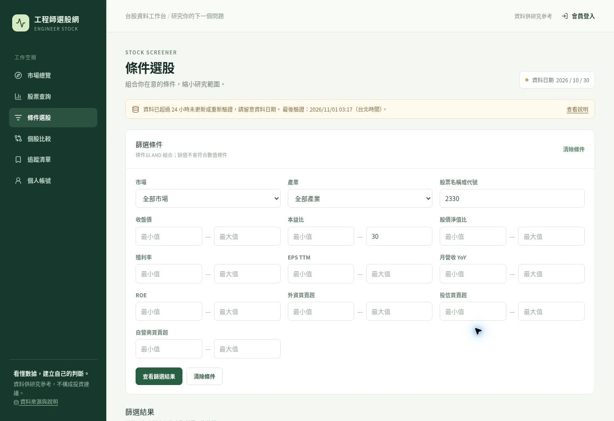
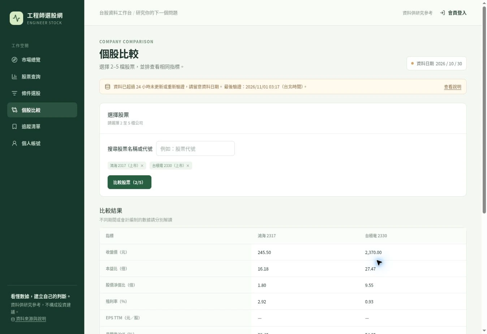

[開啟工程師選股網](https://engineer-stock-web.vercel.app/)。先看資料日期，再查股票、設定條件與比較公司；追蹤清單需要登入。這篇只整理操作方式，程式與架構留在 [MR Blog 的 10 篇技術教學](https://ntustray.github.io/mr-blog/series/engineer-stock/)。

## 先看這三個地方

| 位置 | 要確認什麼 |
| --- | --- |
| 資料日期 | 這批行情屬於哪個交易日 |
| 日行情範圍 | 實際累積幾個交易日，不能把保留上限當成已有歷史 |
| 更新狀態 | 若顯示「使用舊資料」，先確認日期與資料來源 |

2026 年 11 月 3 日核對公開頁面時，行情日期仍是 **2026-10-30**，日行情只有 **1 個交易日**，網站有舊資料提示。保留上限是 30 個日曆天，並不表示已有 30 天可查；實際狀態以頁面為準。

以下截圖沿用先前技術系列的公開操作畫面，用來辨認介面；不是即時行情或本次登入結果。

## 查一家公司

1. 在首頁輸入股票代號或公司名稱，例如 `2330`。這裡只示範搜尋，不代表推薦。
2. 開啟搜尋結果中的公司。
3. 對照個股頁的行情、營收與財報區塊，分別看資料日期。
4. 欄位顯示 `—` 時，代表沒有可呈現的值，不能自行當成 `0`。

也可以從[股票查詢](https://engineer-stock-web.vercel.app/stocks)瀏覽上市、上櫃清單。

圖中的累計營收不是股價 K 線，累計 EPS 也不能直接當成 EPS TTM。資料不足時，圖表與欄位可能留空。

## 用條件縮小範圍

開啟[條件選股](https://engineer-stock-web.vercel.app/screener)：

1. 選擇市場、產業，或填入名稱／代號。
2. 填寫想研究的數值範圍，例如收盤價、本益比或殖利率。
3. 按「查看篩選結果」。
4. 調整排序，開啟個股頁核對資料。
5. 想重新設定時，按「清除條件」。

條件以 **AND** 組合，需同時符合；缺值不會通過數值條件。若選完變成 0 筆，先移除部分條件，確認是否因資料尚未提供而被排除。

篩選條件會保留在網址中。複製網址可以保留條件；資料更新後，符合條件的公司仍可能改變。

## 把公司放在一起比較

開啟[個股比較](https://engineer-stock-web.vercel.app/compare)：

1. 搜尋並選取 **2–5 檔**股票。
2. 按「比較股票」。
3. 逐項比較相同指標，保留缺值。
4. 財報期間、幣別或編制不同時，分開解讀；若頁面提示無法安全比較，就先回個股頁確認。

## 使用追蹤清單

1. 從右上角「會員登入」進入登入頁，沒有帳號時先註冊。
2. 依畫面完成 Email 驗證，再登入。
3. 在個股頁加入追蹤，開啟「追蹤清單」確認。
4. 重新整理，確認清單仍在；移除後也再確認一次。

未登入開啟追蹤清單會進入登入流程。公開查詢、條件選股與比較不需先登入。本文沒有重新驗證寄信、登入及登入後儲存；若驗證信或登入無法完成，可先使用公開功能。

## 資料怎麼解讀

網站整理公開資料快照，可能延遲、修正或缺漏，不是即時報價。需要核對來源與更新方式時，開啟[資料來源與說明](https://engineer-stock-web.vercel.app/data-sources)。

選股結果是縮小研究範圍的入口；單一指標或一次篩選不能取代公司研究。網站與本文均不提供買賣建議。
