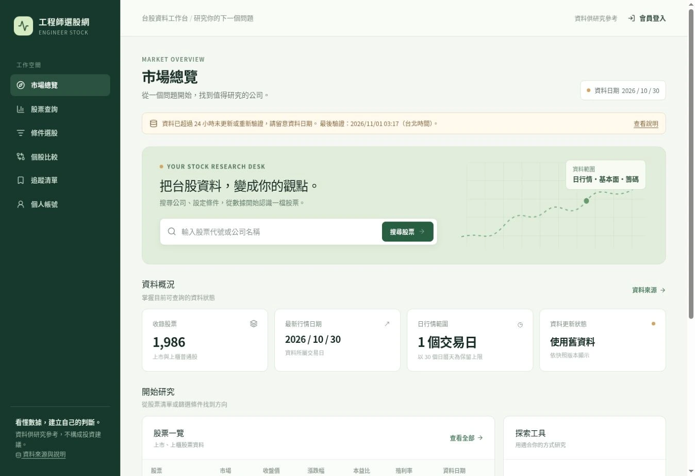
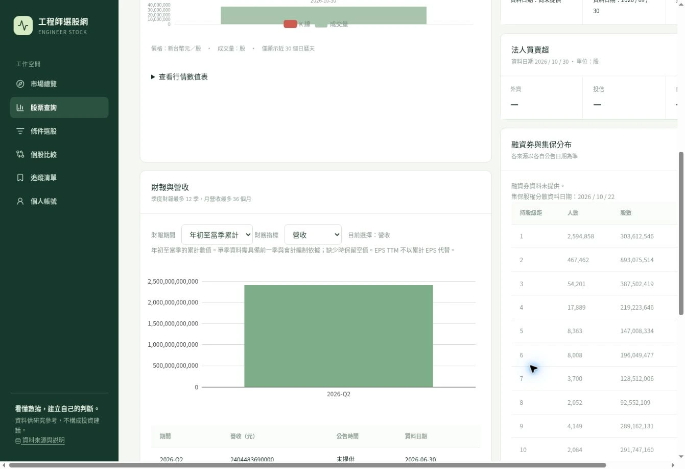
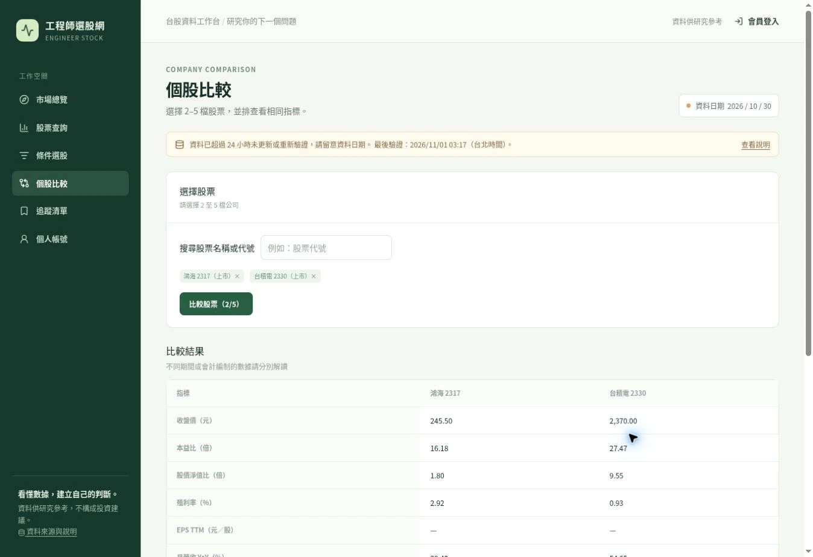
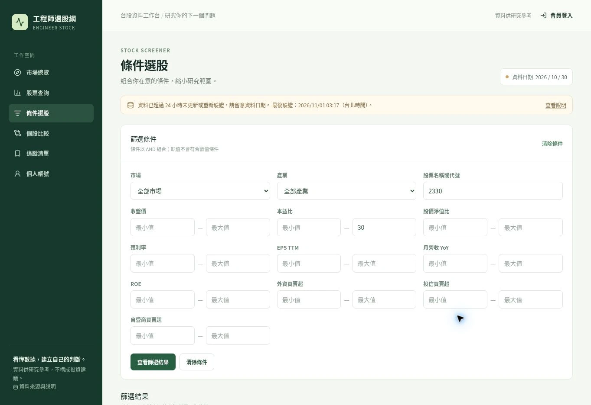

在選股網輸入 2330，畫面可能同時顯示日行情、月營收和季度財報。這三塊資料各有日期。先確認你看的那格屬於哪一天或哪一季，才不會拿上個交易日的收盤價當即時報價，或把前三季累計 EPS 當成近四季盈餘。[開啟工程師選股網](https://engineer-stock-web.vercel.app/)

2026 年 11 月 3 日核對公開頁面時，最近一筆行情是 10 月 30 日，畫面顯示使用舊資料，當時只累積了一個交易日。網站設的保留上限是 30 個日曆天，打開時要再看畫面寫的實際範圍。下方截圖用來辨認介面。當時的「資料來源與說明」頁面已無法從原連結核對，資料欄位及來源可從公開的技術系列回查。

## 從個股頁讀到可以比較的資料

1. 在首頁輸入公司名稱或代碼，也可以從[股票查詢](https://engineer-stock-web.vercel.app/stocks)看上市、上櫃清單。
2. 打開個股頁，分別看行情、月營收及財報的日期。畫面顯示 `—`，就把該欄當缺值。營收圖畫的是收入，跟股價走勢是兩回事。
3. 到[個股比較](https://engineer-stock-web.vercel.app/compare)選 2–5 檔，再核對指標期間、幣別及編制。如果畫面提示不能比較，回到各公司頁確認差在哪裡。

## 篩到零筆時，先拿掉一個條件

到[條件選股](https://engineer-stock-web.vercel.app/screener)選市場或產業，再填收盤價、本益比或殖利率範圍。按「查看篩選結果」後，可以調排序並點進個股。所有條件都要同時符合。某家公司沒有本益比，即使符合價格範圍，也不會通過本益比篩選。先拿掉最可能缺資料的條件試一次，再決定要不要縮小範圍。複製網址能保留當下的條件，重開時則會依可用的資料重算。

公開的查詢、篩選和比較可以直接用。追蹤清單需要註冊、完成 Email 驗證並登入，再從個股頁加入。原文未重新驗證寄信與登入後儲存。若要確認有沒有寫入，打開清單後重新整理一次，看看那檔股票是否還在。網站實作另見 [MR Coding 的技術系列](https://ntustray.github.io/mr-blog/series/engineer-stock/)。
